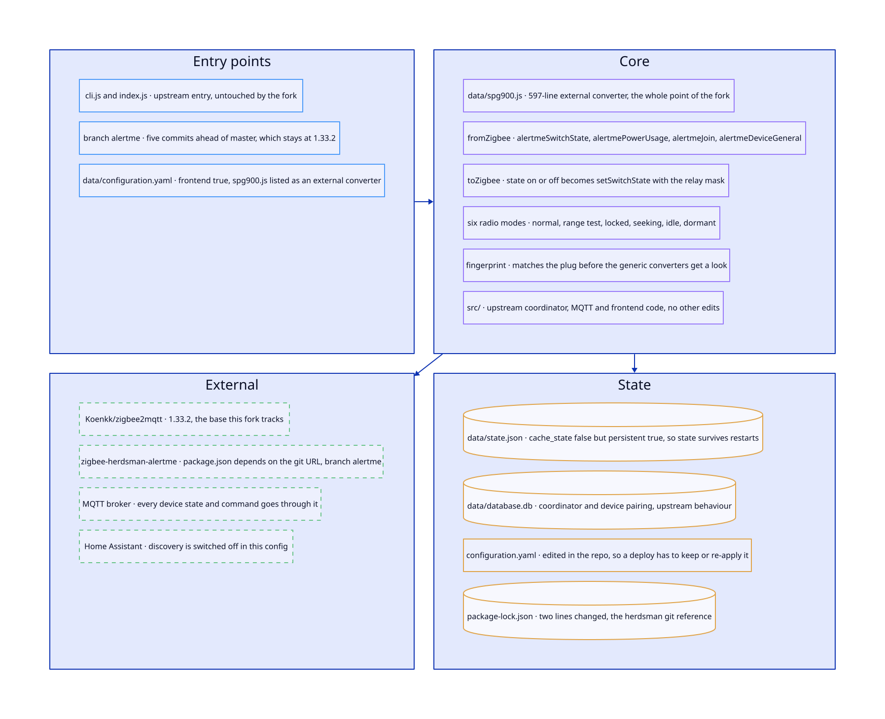

# zigbee2mqtt-alertme — zigbee2mqtt 1.33.2 with one external converter for an AlertMe SPG900 plug

A fork of [Koenkk/zigbee2mqtt](https://github.com/Koenkk/zigbee2mqtt) 1.33.2 whose `alertme` branch adds a single external converter, `data/spg900.js`, plus the herdsman fork that knows the plug's private clusters.

## Read it left to right

- **The fork is a converter and a config file, not a patch.** The whole delta is `data/spg900.js` (597 lines), eleven added lines in `data/configuration.yaml` (`frontend: true`, `external_converters`, `cache_state: false` with `cache_state_persistent: true`) and a two-line swap in `package.json` that points `zigbee-herdsman` at `d3nd3/zigbee-herdsman-alertme#alertme`. No upstream source under `src/` is edited, so rebasing onto a newer 1.33.x is mostly a converter-compatibility question.
- **`spg900.js` is a build artefact committed as a converter.** It opens with the `__importDefault` helper TypeScript emits and pulls in `fromZigbee`, `toZigbee`, `exposes` and `legacy` by `require`, then defines the four `alertme*` converters inline. It has to live outside `src/` because that is how external converters are loaded, but it means the readable source is not in this repo.
- **The plug's rhythm is in the converter's comments, and it is fixed.** `powerDemand` every 10 s, heartbeat every 30 s, `powerConsumption` every minute; six radio modes (`normal`, `range_test`, `locked`, `seeking`, `idle`, `dormant`) with dormant as the mode right after pairing; timers reset whenever power is lost; `HNF 2` is understood as unpair. Those constants are why the plug looks dead for the first minutes and why unplugging it changes its behaviour.
- **State is turned on and off through a relay mask, not a plain boolean.** `setSwitchState` carries `state` and `relay_mask`, so one command can address several switches on the same device (the plug has a tamper switch as well), and the converter has to read the mask back to know which output moved.
- **Two dependencies must move together.** The converter relies on cluster definitions that only exist in the herdsman fork, and that fork is pulled from a git URL on branch `alertme`; a plain `npm ci` against upstream herdsman parses the frames as unknown clusters. `data/configuration.yaml` is edited in-place in the repo, so a deploy that overwrites `data/` loses the converter registration.

---

Diagram source: [`docs/system.d2`](docs/system.d2) · render with [`scripts/render-diagram.sh`](scripts/render-diagram.sh) (writes `docs/system.svg` for light and dark, plus `docs/system.png`).
